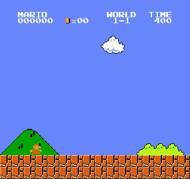

# mario bench

a benchmark for decision models playing super mario bros. models receive screenshots
or game state and choose controller inputs

[demo](https://mario.nicholasg.com/)

## results

22 models have recorded state attempts. the tables show individual development
runs, not model averages or a ranking. earlier verified clears and all 8 replay
showcases remain in [the recorded examples](results/README.md)

the live website shows the broader development observations and the 8 replay
showcases, with incomplete and aborted attempts labelled separately

### state: common input profile

these runs use the same prompt, observer and 4-frame cadence. the cohort was
assembled after development, with a stagnation stop. incomplete api calls have no
score. pplx's earlier clear finished within the common budget, but its original
configured cap was larger. no comparable aggregate is claimed

| model | observed progress | clear time (game s) | evidence |
| --- | ---: | ---: | --- |
| decider v1.2 | 100.00% | 20.13 | [trace](results/traces/pplx-state-clear.json) · [profile](results/profiles/pplx-state-clear.json) |
| mercury decide | 63.41% | - | [trace](results/traces/state-c4-inception--mercury-decide.json) · [profile](results/profiles/state-c4-inception--mercury-decide.json) |
| span-02 | 55.94% | - | [trace](results/traces/state-c4-respan--span-02.json) · [profile](results/profiles/state-c4-respan--span-02.json) |
| clef | 47.48% | - | [trace](results/traces/state-c4-cloudflare--clef.json) · [profile](results/profiles/state-c4-cloudflare--clef.json) |
| microsoft-decision-1 | 44.25% | - | [trace](results/traces/state-c4-microsoft--microsoft-decision-1.json) · [profile](results/profiles/state-c4-microsoft--microsoft-decision-1.json) |
| jev 1.13 | 21.88% (aborted) | - | [trace](results/traces/state-c4-typesafe--jev-1-13.json) · [profile](results/profiles/state-c4-typesafe--jev-1-13.json) |
| d1-ultra | 20.47% | - | [trace](results/traces/state-c4-liquid--d1-ultra.json) · [profile](results/profiles/state-c4-liquid--d1-ultra.json) |
| drex max | 20.19% | - | [trace](results/traces/state-c4-nace-ai--drex-max.json) · [profile](results/profiles/state-c4-nace-ai--drex-max.json) |
| drex v1.5 | 17.81% (aborted) | - | [trace](results/traces/state-c4-nace-ai--drex-v1-5.json) · [profile](results/profiles/state-c4-nace-ai--drex-v1-5.json) |
| jev 1.14 | 17.81% (aborted) | - | [trace](results/traces/state-c4-typesafe--jev-1-14.json) · [profile](results/profiles/state-c4-typesafe--jev-1-14.json) |
| mammoth 1 | 17.81% (aborted) | - | [trace](results/traces/state-c4-baseten--mammoth-1.json) · [profile](results/profiles/state-c4-baseten--mammoth-1.json) |
| drex v2.0 | 17.75% (aborted) | - | [trace](results/traces/state-c4-nace-ai--drex-v2-0.json) · [profile](results/profiles/state-c4-nace-ai--drex-v2-0.json) |
| clef omni | 13.17% (aborted) | - | [trace](results/traces/state-c4-cloudflare--clef-omni.json) · [profile](results/profiles/state-c4-cloudflare--clef-omni.json) |
| elephant 1 | 8.75% | - | [trace](results/traces/state-c4-baseten--elephant-1.json) · [profile](results/profiles/state-c4-baseten--elephant-1.json) |
| decider flash v1.2 | 8.72% | - | [trace](results/traces/state-c4-perplexity--pplx-decider-flash-v1-2.json) · [profile](results/profiles/state-c4-perplexity--pplx-decider-flash-v1-2.json) |
| joey 1 | 8.72% | - | [trace](results/traces/state-c4-baseten--joey-1.json) · [profile](results/profiles/state-c4-baseten--joey-1.json) |
| d1.1 | 8.72% | - | [trace](results/traces/state-c4-liquid--d1-1.json) · [profile](results/profiles/state-c4-liquid--d1-1.json) |
| clef flash | 8.55% | - | [trace](results/traces/state-c4-cloudflare--clef-flash.json) · [profile](results/profiles/state-c4-cloudflare--clef-flash.json) |
| classify-1 | 0.00% (aborted) | - | [trace](results/traces/state-c4-scaledown--classify-1.json) · [profile](results/profiles/state-c4-scaledown--classify-1.json) |
| solar decide flash | 0.00% (aborted) | - | [trace](results/traces/state-c4-upstage--solar-decide-flash.json) · [profile](results/profiles/state-c4-upstage--solar-decide-flash.json) |
| kev 4b | incomplete | - | [trace](results/traces/state-c4-jaredpalmer--kev-4b.json) · [profile](results/profiles/state-c4-jaredpalmer--kev-4b.json) |
| gpt-6 luna decisions | incomplete | - | [trace](results/traces/state-c4-openai--gpt-6-luna-decisions.json) · [profile](results/profiles/state-c4-openai--gpt-6-luna-decisions.json) |

### pixels only: best observed development runs

these are selected runs with different prompts, controls, crops and history
aborted runs retain observed progress, not a completed benchmark score. a missing
model here means unsupported or not yet measured, never zero

| model | observed progress | clear time (game s) | evidence |
| --- | ---: | ---: | --- |
| mammoth 1 | 81.83% (aborted) | - | [trace](results/traces/pixels-best-baseten--mammoth-1.json) · [profile](results/profiles/pixels-best-baseten--mammoth-1.json) |
| gpt-6 luna decisions | 77.86% | - | [trace](results/traces/pixels-best-openai--gpt-6-luna-decisions.json) · [profile](results/profiles/pixels-best-openai--gpt-6-luna-decisions.json) |
| decider v1.2 | 77.83% | - | [trace](results/traces/pplx-pixels-partial.json) · [profile](results/profiles/pplx-pixels-partial.json) |
| elephant 1 | 61.39% | - | [trace](results/traces/pixels-best-baseten--elephant-1.json) · [profile](results/profiles/pixels-best-baseten--elephant-1.json) |
| mercury decide | 56.30% | - | [trace](results/traces/pixels-best-inception--mercury-decide.json) · [profile](results/profiles/pixels-best-inception--mercury-decide.json) |
| drex max | 56.30% | - | [trace](results/traces/pixels-best-nace-ai--drex-max.json) · [profile](results/profiles/pixels-best-nace-ai--drex-max.json) |
| jev 1.14 | 51.94% | - | [trace](results/traces/jev-pixels-partial.json) · [profile](results/profiles/jev-pixels-partial.json) |
| decider flash v1.2 | 44.31% | - | [trace](results/traces/pixels-best-perplexity--pplx-decider-flash-v1-2.json) · [profile](results/profiles/pixels-best-perplexity--pplx-decider-flash-v1-2.json) |
| jev 1.13 | 34.80% | - | [trace](results/traces/pixels-best-typesafe--jev-1-13.json) · [profile](results/profiles/pixels-best-typesafe--jev-1-13.json) |
| clef | 34.76% | - | [trace](results/traces/pixels-best-cloudflare--clef.json) · [profile](results/profiles/pixels-best-cloudflare--clef.json) |
| clef flash | 34.76% | - | [trace](results/traces/pixels-best-cloudflare--clef-flash.json) · [profile](results/profiles/pixels-best-cloudflare--clef-flash.json) |
| d1-ultra | 27.49% | - | [trace](results/traces/pixels-best-liquid--d1-ultra.json) · [profile](results/profiles/pixels-best-liquid--d1-ultra.json) |
| joey 1 | 20.92% | - | [trace](results/traces/pixels-best-baseten--joey-1.json) · [profile](results/profiles/pixels-best-baseten--joey-1.json) |
| span-02 | 20.38% | - | [trace](results/traces/pixels-best-respan--span-02.json) · [profile](results/profiles/pixels-best-respan--span-02.json) |
| clef omni | 20.25% | - | [trace](results/traces/pixels-best-cloudflare--clef-omni.json) · [profile](results/profiles/pixels-best-cloudflare--clef-omni.json) |
| d1.1 | 12.66% (aborted) | - | [trace](results/traces/pixels-best-liquid--d1-1.json) · [profile](results/profiles/pixels-best-liquid--d1-1.json) |

state uses memory-derived visible geometry and motion. pixels (`image` track) uses
screenshots, crops and past screens where configured, plus rules, controls and timing
every pixels request was audited for the absence of memory-derived game state

clear time is native gameplay frames divided by 60, excluding api waiting time
and available only for completed runs

[results and traces](results/README.md) · [public 22-model roster](results/models.json) · [website data guide](docs/website-data.md)



*pplx decider v1.2, state input, replayed at 2x speed*

<details>
<summary>run locally</summary>

### website

with node.js 24 installed, run from the repository checkout:

```sh
cd web
npm ci
npm run dev
```

open [localhost:3100](http://127.0.0.1:3100). the build prepares the game asset
and published results automatically. no python installation or api key is needed

### model viewer

with python 3.13 and `uv` installed, run from the repository root:

```sh
uv venv --python 3.13 .venv
uv pip install --python .venv/bin/python -r requirements.lock.txt
uv pip install --python .venv/bin/python --no-deps -e .
cp .env.example .env
```

add your `OPENROUTER_API_KEY` to `.env`, then start the viewer:

```sh
.venv/bin/python -m prototype.server
```

open [localhost:8765](http://127.0.0.1:8765). choose a model and input mode, then
press **1 decision** or **run 10 decisions**. it starts paused and muted, so
nothing spends api credits until you ask it to play. the key stays server-side

pause to inspect a decision, or reset for a fresh attempt. the viewer runs
locally; you don't need the hosted demo. `--help` lists model and budget options

### run a benchmark

the roster has 22 state models, with 14 currently passing the screenshot checks

see the [runner configuration](benchmark/models.json) for compatible model/provider pairs

```sh
# show the plan without sending requests
.venv/bin/python -m benchmark.run

# exercise the runner without an api key or paid calls
.venv/bin/python -m benchmark.run --policy fake --frames 96 --output benchmark/runs/offline --execute

# run a real model, with 3 attempts declared in advance
.venv/bin/python -m benchmark.run --models perplexity/pplx-decider-v1.2 --trials 3 --output benchmark/runs/pplx-state --execute

# use pixels only
.venv/bin/python -m benchmark.run --track image --output benchmark/runs/pixels

# select all 4 world 1 levels
.venv/bin/python -m benchmark.run --levels 1-1 1-2 1-3 1-4
```

`--execute` makes paid requests when using the default `openrouter` policy

commands without it only print the plan

paid runs use your openrouter credits and account limits. `--models id ...`,
`--frames` and `--trials` let you choose a smaller run before spending credits

results include a frozen `manifest.json`, request and action logs, input images
where applicable, and `summary.json`. repeat the same command and output path to
resume. use a new directory after changing code, models or settings. uncertain
interrupted requests stop for inspection rather than silently spending twice

</details>

<details>
<summary>methodology, verification and notices</summary>

the aggregate score is **average progress, from 0 to 100**, unavailable for these
selected runs. average all declared attempts within each level, then weight levels
equally. dying keeps legitimate progress; only confirmed game completion gets 100

world 1-1 has a calibrated start and finish. worlds 1-2, 1-3 and 1-4 run too,
but their progress mappings are still uncalibrated

their incomplete runs show unknown progress, and a combined progress score stays
unavailable until those mappings are validated

clear rate is reported separately. the speedrun score uses native gameplay frames
for completed runs only, with lower being better. it reports the completed-only
median, nominal seconds (`frames / 60`) and attempt counts. failed runs have no
speedrun score. api waiting time and internet speed never affect a game score

this is a public development benchmark. prompts and controls have been tuned on
1-1; verified clears show that the models can do it under their recorded settings

a final shared configuration, repeated evaluation and held-out levels are still
ahead. selected successful attempts aren't an aggregate score

### inputs and controls

the game freezes while the model thinks. by default, it chooses 1 of 12 complete
controller inputs, held for exactly 4 native frames

the default budget is 6,000 native frames and 1,500 decisions. first death ends
the attempt

- `state` gives the model compact visible geometry, motion and recent positions
  derived from game memory
- `image` gives it pixels only, plus declared buttons, frame number and action
  interval. no memory-derived positions, velocities, terrain or object lists

screenshots are lossless pngs, enlarged from 256x240 to 512x480 with nearest
neighbour sampling. model/provider identity is checked, and each worker owns its
own emulator. malformed model actions count as failed play; infrastructure
failures leave the comparable aggregate unavailable instead of becoming game losses

### replay checks and reproducibility

for 1-1, progress is `100 * (furthest_valid_x - 40) / (3161 - 40)`

valid progress is sampled every native frame and excludes death, falling and
transition animations. unsuccessful attempts are capped at 99.9. unknown route
mappings never reuse another level's denominator

compare models under the same prompts, input mode, controls, starts, cadence and
budgets. don't pick each model's best run. a single deterministic start doesn't
support a general mario ranking, and image transport acceptance doesn't prove
that pixels influenced a decision

run the offline checks and audit a saved run:

```sh
.venv/bin/python -m prototype.verify_paused
.venv/bin/python -m benchmark.verify_scoring
.venv/bin/python -m benchmark.smoke
.venv/bin/python -m benchmark.audit benchmark/runs/offline
```

these cover paused inference, exact stepping, image isolation, score boundaries,
worker isolation, replay hashes and recovery. `benchmark.verify_clear` verifies
recorded development clears against native requests, actions and game frames

export the current development candidate's code, prompts, roster and runtime:

```sh
.venv/bin/python -m benchmark.release --output benchmark/runs/current-candidate/release-manifest.json
```

read the [full protocol](benchmark/PROTOCOL.txt) and
[machine-readable settings](benchmark/protocol.json) for the scoring contract

### repository

- `prototype/` contains the emulator, decision client and local viewer
- `benchmark/` contains the runner, scoring, protocol and replay tools
- `web/` contains the website and browser-local human game
- `results/` contains public development examples, profiles, action traces and replays

`requirements.lock.txt` pins the environment. secrets, environments, run logs,
screenshots and recordings stay ignored. `playground/` is local scratch space

this repository includes no rom files or game binaries; the emulator dependency
supplies its game data

[dependency notices](docs/third-party-notices.md)

</details>
